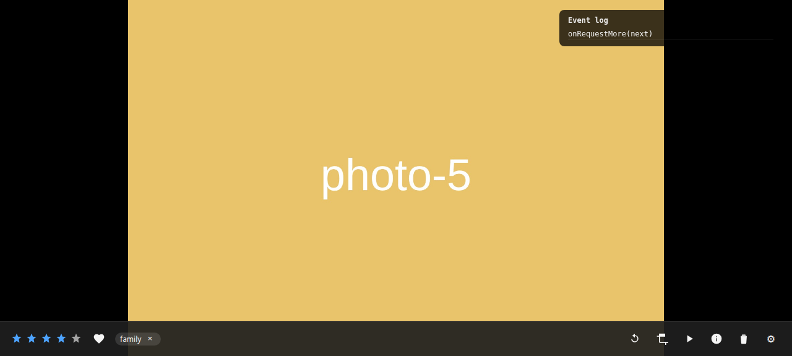

# @icenux/wpview

Touch-first photo viewer and editor. A standalone frontend plugin with no API,
no fetch and no permission logic. wpview emits intent (`onRate`, `onEdit`,
`onDelete`, …) and the consumer owns the policy. See
[`CONTRACT.md`](./CONTRACT.md).



Screenshot from `playground/` — capability-gated toolbar, optimistic rating,
removable tag chips, favorite.

## Development

```bash
npm install
npm run dev        # playground against mock data, no backend
npm test           # Vitest + Testing Library
npm run typecheck
npm run lint
npm run build      # Vite library mode -> dist/ (ESM + .d.ts)
```
